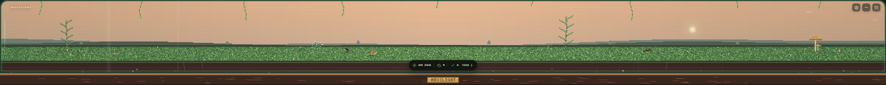
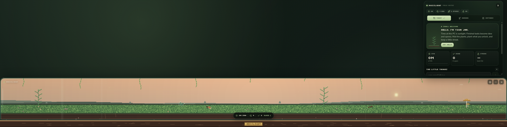
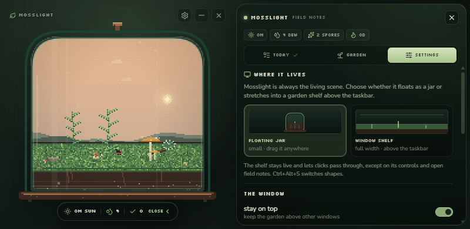

# Mosslight

A tiny pixel terrarium that lives on your desktop and grows while you work.

Time at your PC is sunlight. The tasks you finish become dew and spores. Plants
unfurl, creatures move in, and the whole garden keeps moving all day — either as
a small floating jar or as a long living shelf above the taskbar.


## How it grows

**Sunlight** is the time your PC is awake and you are actually there. Every active
minute feeds every plant, up to six hours a day so a normal day is enough. After
that the jar rests until tomorrow.

**Tasks** are the little things. Finishing one drops `+4 dew` and `+1 spore`,
grows every plant a touch, and starts or extends a daily streak. Completed tasks
clear at midnight; unfinished ones stay.

**Misting** spends `2 dew` and adds a little growth to every plant at once, with a
soft rain animation inside the glass.

**Spores** plant new species into the eight slots of the garden. Each seed costs
spores and matures at its own pace:

| seed | cost | sunlight to mature | unlocked by |
| --- | --- | --- | --- |
| fern | 1 spore | 5 h | always |
| mushroom | 1 spore | ~3 h | always |
| flower | 2 spores | 7 h | 3 tasks finished |
| succulent | 2 spores | 10 h | 10 tasks finished |
| vine | 3 spores | 12 h | a 3-day streak |
| crystal | 4 spores | 20 h | 10 focused hours |

**Residents** arrive as the garden's *harmony* rises. Harmony counts finished
tasks, mature plants, species variety and streak length. A snail is already home;
a ladybug, firefly and frog follow. Some only come out at night.

**Breaks** pay. If you step away for a few minutes after a long stretch at the
keyboard, the garden gives you `+2 dew`. Closing the window keeps it running in
the tray.

The scene follows your local clock: soft dawn, bright midday, amber evening and a
night sky with stars, fireflies and a sleeping garden.

## Two ways to live

Mosslight is always the real, animated scene. Choose the shape in settings, the
tray menu, or with `Ctrl+Alt+S`:

- **Floating jar** — a small frameless jar you can drag anywhere. It remembers
  its spot between sessions.
- **Window shelf** — a full-width, low vivarium anchored to the bottom of the
  work area, directly above the taskbar. A young garden spreads its plants out
  across the whole shelf instead of bunching at one end.

Both shapes share the same garden, so switching never resets growth or
residents. The field notes open above the shelf and close back down to the thin
strip.



## A window you can click through

The shelf is wide, so it should not eat every click meant for the desktop. In
shelf mode Mosslight lets mouse events pass through everything except its
controls, the status pill, and an open field-notes drawer. Move toward a control
and it becomes clickable; move away and clicks go back to whatever is behind it.
Ghost mode (`Ctrl+Alt+T`) does the same thing for the jar.

The shelf belongs to the display nearest the jar's remembered home. Move the
floating jar to another monitor, then switch back to the shelf, to move it there.



Other window controls:

- The pill under the garden opens **field notes**: today, garden, settings.
- The tray menu has show/hide, mist, window shape, pause, ghost mode,
  always-on-top, start-with-Windows and quit.
- `Ctrl+Alt+S` switches jar ↔ shelf; `Ctrl+Alt+M` shows or hides Mosslight.
- Growth can be paused without closing the window. Reduced motion and atmosphere
  toggles live in settings.



## Living, not a snapshot

Earlier versions could render a still portrait into the desktop wallpaper. That
is gone: a snapshot stops moving the moment it is taken, and the whole point is
the living scene.

Windows also runs the lock screen on a separate secure desktop, so an ordinary
desktop app cannot draw an animated window there. Rather than ship a still image
pretending to be one, Mosslight has no lock-screen mode. The jar and the shelf
are the honest, living thing.

## Everything stays on this machine

No account, no sync, no analytics, no network requests. Mosslight only knows how
long the PC has been awake and which tasks you finish in it.

State lives in `%APPDATA%\Mosslight\terrarium.json` (Open data folder in
settings). Window position, ghost mode and always-on-top live beside it in
`window.json`. Saves are debounced and written atomically.

## Run it

Requires Node 22+ and npm.

```bash
npm install
npm run dev:desktop     # Vite + Electron with hot reload
npm run start:desktop   # production build, then Electron
```

Other scripts:

```bash
npm run check           # typecheck + growth-rule smoke tests
npm run smoke           # growth / streaks / planting invariants only
npm run icons           # regenerate every icon from the 32x32 pixel drawing
npm run shot            # render UI screenshots into build/shots
npm run dist:win        # NSIS installer in release/
```

The browser preview also works with `npm run dev` — the same UI, with a
localStorage-backed state and a simulated presence timer. Tray, shelf sizing and
window controls are desktop-only.

## Layout

```
electron/
  main.cjs          windows, shelf layout, tray, presence, shortcuts, IPC
  preload.cjs       allow-listed bridge
  assets/           generated jar icons
src/
  lib/
    scene.ts        the pixel scene: sky, soil, glass, jar and shelf
    plants.ts       procedurally drawn species that grow and sway
    creatures.ts    snail, ladybug, frog, firefly
    state.ts        growth rules, tasks, streaks, normalization
    useTerrarium.ts React hook: persistence, presence, display mode, toasts
    bridge.ts       desktop bridge, with a web fallback
    palette.ts      16-bit palette and day/night keys
  components/       jar/shelf canvas, drawer, today, garden, settings
scripts/
  make-icons.mjs    hand-rolled PNG/ICO encoder, no image dependencies
  smoke.ts          the growth-rule checks
```

## Notes

- Icons and all art are generated in code. There are no sprite sheets or image
  assets to keep in sync, and no runtime dependencies beyond React, Electron and
  lucide icons.
- Growth constants are at the top of `src/lib/state.ts`; species and unlock
  rules are in `src/lib/species.ts`; planting spots are in `src/lib/layout.ts`
  and `src/lib/scene.ts`.
- The Windows installer is unsigned. SmartScreen may ask for confirmation the
  first time it runs.
- Transparent always-on-top windows can behave differently in remote desktop
  sessions. The shelf follows the display work area, so unusual taskbars or
  multi-monitor layouts may put it on a different screen than expected; the tray
  and settings toggles still work.
- The shelf is a normal window, not a wallpaper replacement. Hiding Mosslight
  hides the shelf too, and it reappears when you show it again.

MIT licensed.
