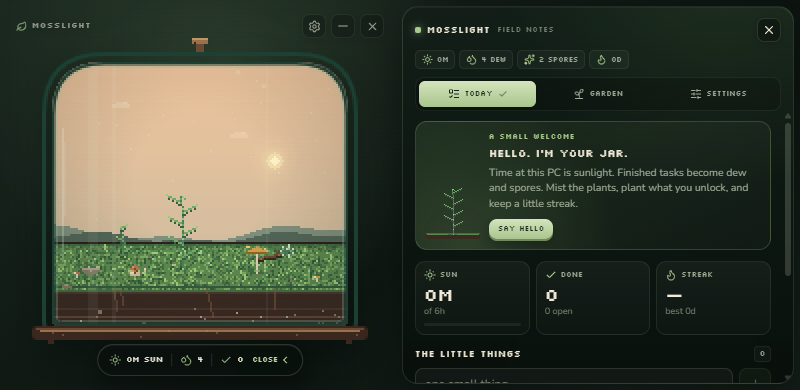
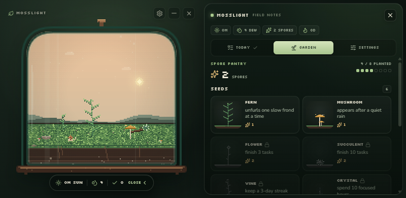
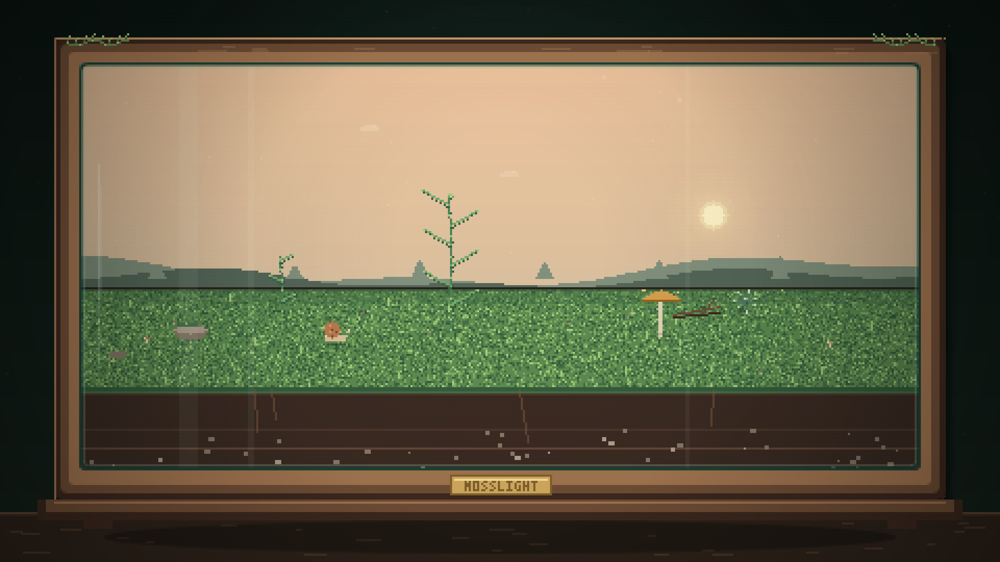

# Mosslight

A tiny pixel terrarium that lives on your desktop and grows while you work.

Time at your PC is sunlight. The tasks you finish become dew and spores. Plants
unfurl, creatures move in, and the jar can render itself into your wallpaper and
lock screen so it is still there when you step away.



## How it grows

**Sunlight** is the time your PC is awake and you are actually there. Every active
minute feeds every plant, up to six hours a day so a normal day is enough. After
that the jar rests until tomorrow.

**Tasks** are the little things. Finishing one drops `+4 dew` and `+1 spore`,
grows every plant a touch, and starts or extends a daily streak. Completed tasks
clear at midnight; unfinished ones stay.

**Misting** spends `2 dew` and adds a little growth to every plant at once, with a
soft rain animation inside the glass.

**Spores** plant new species into the eight slots of the jar. Each seed costs
spores and matures at its own pace:

| seed | cost | sunlight to mature | unlocked by |
| --- | --- | --- | --- |
| fern | 1 spore | 5 h | always |
| mushroom | 1 spore | ~3 h | always |
| flower | 2 spores | 7 h | 3 tasks finished |
| succulent | 2 spores | 10 h | 10 tasks finished |
| vine | 3 spores | 12 h | a 3-day streak |
| crystal | 4 spores | 20 h | 10 focused hours |

**Residents** arrive as the jar's *harmony* rises. Harmony counts finished tasks,
mature plants, species variety and streak length. A snail is already home; a
ladybug, firefly and frog follow. Some only come out at night.

**Breaks** pay. If you step away for a few minutes after a long stretch at the
keyboard, the jar gives you `+2 dew`. Closing the window keeps it running in the
tray.

The scene follows your local clock: soft dawn, bright midday, amber evening and a
night sky with stars, fireflies and a sleeping jar.

## The window

Mosslight is a frameless, transparent, always-on-top jar. Drag it anywhere and it
remembers where it was.

- The pill under the jar opens **field notes**: today, garden, settings.
- The tray menu has show/hide, mist, portrait snapshots, pause, ghost mode,
  always-on-top and start-with-Windows.
- `Ctrl+Alt+T` toggles **ghost mode** (clicks pass through to whatever is behind
  the jar); `Ctrl+Alt+M` shows or hides the jar.
- Growth can be paused without closing the jar. Reduced motion and atmosphere
  toggles live in settings.
- The pill and the field-notes button are how you open and close the notes.



## Wallpaper and lock screen

Windows does not let a normal desktop app draw live content on the lock screen.
So Mosslight does the honest thing: it renders the living jar to a still portrait
and sets that instead.

- **Desktop** — the portrait is written to
  `%APPDATA%\Mosslight\portraits\` and applied with the Win32
  `SystemParametersInfo` API. The previous wallpaper is backed up first, and
  *restore my previous wallpaper* puts it back.
- **Lock screen** — the portrait is copied to
  `Pictures\Mosslight\lock-screen.png` and offered to the Windows lock-screen API.
  Some Windows configurations still require you to pick that file once under
  **Settings → Personalisation → Lock screen**. There is a button in Mosslight
  that opens that page for you. This is a Windows restriction, not a missing
  feature.
- Snapshots can run every 30 minutes, hourly, every 3 or 6 hours, or on demand.
- macOS gets a live wallpaper change through System Events. Linux uses
  `gsettings`. Lock-screen output is Windows-only for now.

The portrait is not a screenshot of the widget. It is redrawn from the same scene
code at your screen resolution — a wide wooden display case with the terrarium
inside, its brass plaque, and the jar's current plants and residents.



## Everything stays on this machine

No account, no sync, no analytics, no network requests. The jar only knows how
long the PC has been awake and which tasks you finish in it.

State lives in `%APPDATA%\Mosslight\terrarium.json` (Open data folder in
settings). Window position and the wallpaper backup live beside it in
`window.json`. Saves are debounced and written atomically.

## Run it

Requires Node 22+ and npm.

```bash
npm install
npm run dev:desktop     # Vite + Electron with hot reload
npm run start:desktop   # production build, then Electron
```

Other scripts:

```bash
npm run check           # typecheck + growth-rule smoke tests
npm run smoke           # growth / streaks / planting invariants only
npm run icons           # regenerate every icon from the 32x32 pixel drawing
npm run shot            # render UI + portrait screenshots into build/shots
npm run dist:win        # NSIS installer in release/
```

The browser preview also works with `npm run dev` — the same UI, with a
localStorage-backed state and a simulated presence timer. Wallpaper and tray
features are desktop-only.

## Layout

```
electron/
  main.cjs          window, tray, presence, portraits, shortcuts, IPC
  preload.cjs       allow-listed bridge
  assets/           generated jar icons
src/
  lib/
    scene.ts        the whole pixel scene: sky, soil, glass, effects
    plants.ts       procedurally drawn species that grow and sway
    creatures.ts    snail, ladybug, frog, firefly
    state.ts        growth rules, tasks, streaks, normalization
    useTerrarium.ts React hook: persistence, presence, snapshots, toasts
    bridge.ts       desktop bridge, with a web fallback
    palette.ts      16-bit palette and day/night keys
  components/       jar canvas, drawer, today, garden, settings
scripts/
  make-icons.mjs    hand-rolled PNG/ICO encoder, no image dependencies
  smoke.ts          the growth-rule checks
```

## Notes

- Icons and all art are generated in code. There are no sprite sheets or image
  assets to keep in sync, and no runtime dependencies beyond React, Electron and
  lucide icons.
- Growth constants are at the top of `src/lib/state.ts`; species and unlock
  rules are in `src/lib/species.ts`; planting spots are in `src/lib/layout.ts`.
- The Windows installer is unsigned. SmartScreen may ask for confirmation the
  first time it runs.
- Transparent always-on-top windows can behave differently in remote desktop
  sessions, and some managed machines block login items or wallpaper changes.
  In those cases the tray and the settings toggles still work; only the blocked
  action is skipped.

MIT licensed.
